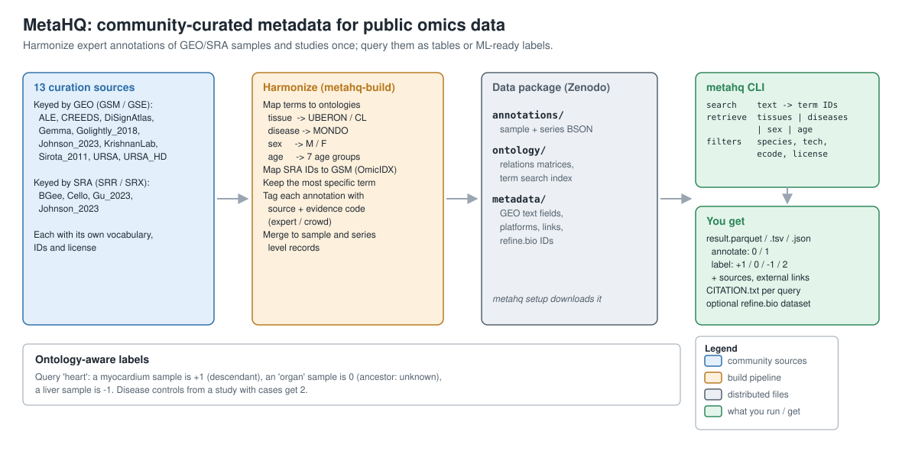

<div align="left">
    
</div>


[](https://app.readthedocs.org/projects/meta-hq/badge/?version=latest)

[](https://doi.org/10.5281/zenodo.17663086)

A platform for harmonizing and distributing community-curated high-quality metadata of public omics samples and datasets.
See our publication at [https://doi.org/10.1093/bioinformatics/btag814](https://doi.org/10.1093/bioinformatics/btag814).



GEO and SRA hold millions of transcriptomes, but what each sample *is* (its tissue,
disease, sex or age) is free text written by each submitter. Many groups have
curated parts of that metadata by hand. MetaHQ collects 13 of those curation
efforts, maps them to shared vocabularies, and serves them through one CLI:

- **Four attributes:** tissue and cell type ([UBERON](https://www.ebi.ac.uk/ols4/ontologies/uberon)/[CL](https://www.ebi.ac.uk/ols4/ontologies/cl)),
  disease ([MONDO](https://www.ebi.ac.uk/ols4/ontologies/mondo)), sex, and age group.
- **Two levels:** GEO samples (`GSM`) and studies (`GSE`), with SRA IDs where known.
- **Ontology-aware:** asking for "heart" also returns samples annotated to "myocardium".
- **ML-ready labels:** `--mode label` gives +1 / 0 (unknown) / -1 per term, and marks
  disease controls from case studies with 2.
- **Filters:** species (human, mouse, rat, zebrafish, fly), technology (RNA-seq,
  microarray), evidence (expert or crowd-sourced) and source license.
- **Provenance:** each row names its sources; each query writes a `CITATION.txt`.

## License and Attribution

- **Database:** [](https://creativecommons.org/licenses/by-nc/4.0/)
- **Software:** [](LICENSE)

The MetaHQ annotation database is licensed under CC BY-NC 4.0 because it integrates
community-curated annotations from multiple sources with NonCommercial restrictions.
The command-line tool is licensed under BSD 3-Clause.

**For commercial use:** Obtain permissions from NC-restricted sources OR use only commercial-compatible annotations.
See [Terms and Conditions](docs/about/terms_conditions.md).

## Status

| Package | Version                                                                                                                                                                  | Tests                                                                                            |
| ------- | ------------------------------------------------------------------------------------------------------------------------------------------------------------------------ | ------------------------------------------------------------------------------------------------ |
| core    |                                                                                                        |            |
| cli     |                                                                                                          |             |
| build   |  |  |

Our codebase is permanently archived on SoftwareHeritage at [https://archive.softwareheritage.org/browse/origin/directory/?origin_url=https://github.com/krishnanlab/meta-hq&visit_type=git](https://archive.softwareheritage.org/browse/origin/directory/?origin_url=https://github.com/krishnanlab/meta-hq&visit_type=git).

## Setup

### 1. Install metahq-cli

```bash
pip install metahq-cli
```

### 2. Download the MetaHQ database and configure the package

```bash
metahq setup
```

## Example

Find the term ID for a tissue, then get labels for every human RNA-seq sample
with a tissue annotation:

```bash
metahq search --query heart --type tissue --ontology UBERON -k 3
metahq retrieve tissues --terms "UBERON:0000948" --mode label \
    --metadata "sample,series" --output heart_labels
```

`heart_labels/result.parquet` has one row per sample:

```text
sample      series             sources  external_links  UBERON:0000948
GSM1002540  GSE40819|GSE40820  Gu_2023                   -1   <- annotated to another tissue
GSM1101970  GSE45326           Gu_2023                    1   <- heart or a part of it
...
```

and `heart_labels/CITATION.txt` lists the sources to cite. More recipes,
including case/control studies, study-level search, license filtering and
sex/age covariates, are in [use cases](docs/user-guide/use-cases.md).

## Documentation

Visit the MetaHQ documentation page at [meta-hq.readthedocs.io/en/latest](https://meta-hq.readthedocs.io/en/latest/).

- [How MetaHQ works](docs/concepts/overview.md): attributes, levels, evidence codes, annotate vs label
- [Data model](docs/concepts/data-model.md): files in the data package and columns in each result
- [Use cases](docs/user-guide/use-cases.md): common queries, each exercised by the test suite
- [Retrieve reference](docs/user-guide/retrieve.md): every option of `metahq retrieve`

## Repository layout

| Path | Contents |
| --- | --- |
| `packages/cli` | `metahq-cli`, the `metahq` command ([PyPI](https://pypi.org/project/metahq-cli/)) |
| `packages/core` | `metahq-core`: querying, ontology propagation and export ([PyPI](https://pypi.org/project/metahq-core/)) |
| `packages/db_build` | `metahq-build`: the pipeline that builds the data package (not on PyPI) |
| `docs/` | this documentation (MkDocs); figures are generated by `scripts/docs_figures.py` |
| `demo/` | a guided CLI walkthrough |
| `data/`, `scripts/`, `notebook/`, `figures/`, `results/` | build inputs and the analyses behind the paper |

## Demo

We provide a demo for the CLI [here](demo/README.md).

## Development

See dev install instructions [here](docs/developer/setup.md).
