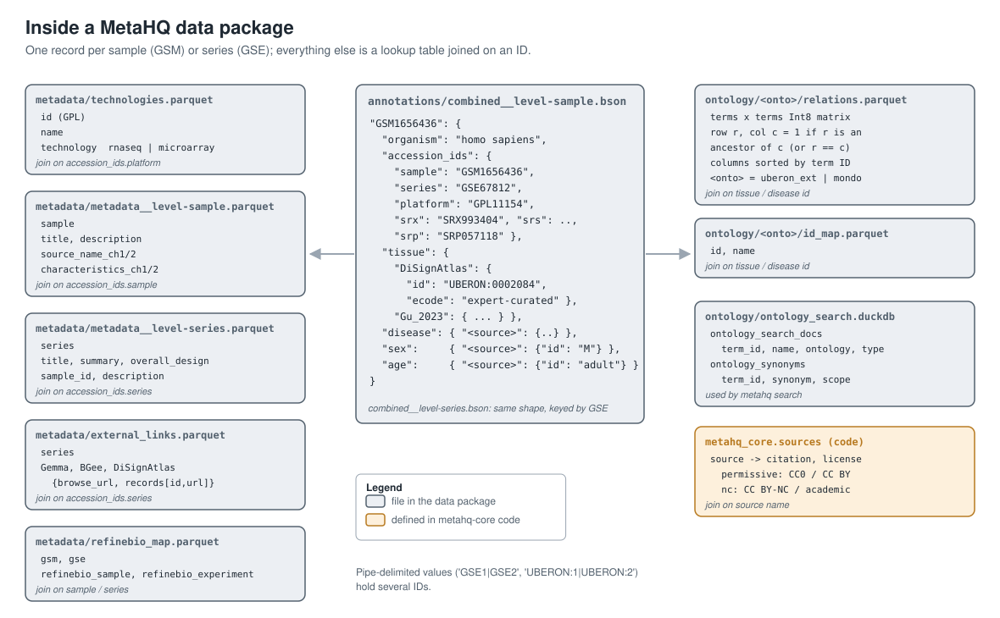

# Data model

`metahq setup` downloads the MetaHQ *data package* from Zenodo into a data
directory (default `~/.metahq_data`) and records where it is in
`~/MetaHQ/config.yaml`. This page describes what is in that package, so you can
read it directly with Polars, DuckDB or any BSON reader, and so you know what
each column of a `metahq retrieve` result means.



## Layout

```text
<data_dir>/
├── annotations/
│   ├── combined__level-sample.bson     # one record per GEO sample (GSM)
│   └── combined__level-series.bson     # one record per GEO series (GSE)
├── metadata/
│   ├── metadata__level-sample.parquet  # GEO free-text fields per sample
│   ├── metadata__level-series.parquet  # GEO free-text fields per series
│   ├── technologies.parquet            # GEO platform (GPL) -> rnaseq | microarray
│   ├── external_links.parquet          # series -> pages in Gemma, Bgee, DiSignAtlas
│   └── refinebio_map.parquet           # GSM/GSE -> refine.bio sample/experiment IDs
└── ontology/
    ├── uberon_ext/                     # UBERON + CL (tissues and cell types)
    │   ├── relations.parquet           # terms x terms ancestor matrix
    │   ├── id_map.parquet              # term ID -> name
    │   ├── names_synonyms.json         # term ID -> name and scoped synonyms
    │   └── systems.txt                 # broad "system" terms used by the build
    ├── mondo/                          # same four files for MONDO (diseases)
    └── ontology_search.duckdb          # index used by `metahq search`
```

`external_links.parquet` and `refinebio_map.parquet` were added in database
v1.2. `metahq validate` checks every file against the checksums for your
database version.

## Annotation records (BSON)

The two `.bson` files each hold a single BSON document: a mapping from an
accession to its record. A sample record looks like this (real record, `srs`
shortened):

```json
"GSM1656436": {
  "organism": "homo sapiens",
  "accession_ids": {
    "sample": "GSM1656436",
    "series": "GSE67812",
    "platform": "GPL11154",
    "srx": "SRX993404",
    "srs": "...",
    "srp": "SRP057118"
  },
  "tissue": {
    "DiSignAtlas": {"id": "UBERON:0002084", "ecode": "expert-curated"},
    "Gu_2023":     {"id": "UBERON:0002084", "ecode": "expert-curated"}
  },
  "disease": {
    "Gu_2023":     {"id": "MONDO:0008056", "ecode": "expert-curated"},
    "KrishnanLab": {"id": "MONDO:0008056", "ecode": "expert-curated"}
  }
}
```

| Key | Type | Notes |
| --- | --- | --- |
| `organism` | string | scientific name, e.g. `homo sapiens`; series spanning several species are pipe-joined (`homo sapiens\|mus musculus`) |
| `accession_ids` | object | GEO IDs `sample`, `series`, `platform`, and SRA IDs `srx`, `srs`, `srp` when known. A sample in several series has `series` like `GSE1\|GSE2` |
| `tissue`, `disease`, `sex`, `age` | object | present only if some source annotated that attribute. Keys are source names, values are one annotation |
| `<attribute>.<source>.id` | string | UBERON/CL ID (tissue), MONDO ID (disease, `MONDO:0000000` = control), `M`/`F` (sex) or an age group (age). Several IDs are pipe-joined |
| `<attribute>.<source>.ecode` | string | `expert-curated` or `crowd-sourced` |

Series records (`combined__level-series.bson`) have the same shape, are keyed
by GSE, and have only `series`, `platform` and (if known) `srp` in
`accession_ids`.

To read a file directly:

```python
from bson import BSON  # installed with metahq-core (pymongo)

with open("annotations/combined__level-sample.bson", "rb") as f:
    samples = BSON(f.read()).decode()

samples["GSM1656436"]["tissue"]
```

## Lookup tables (Parquet)

| File | Columns | Joined on |
| --- | --- | --- |
| `technologies.parquet` | `id` (GPL), `name`, `technology` (`rnaseq` or `microarray`) | `accession_ids.platform`; drives the `tech` filter |
| `metadata__level-sample.parquet` | `sample`, `title`, `description`, `source_name_ch1`, `characteristics_ch1`, `source_name_ch2`, `characteristics_ch2` | `sample` |
| `metadata__level-series.parquet` | `series`, `title`, `summary`, `overall_design`, `sample_id`, `description` | `series` |
| `external_links.parquet` | `series`, then one struct column per source (`Gemma`, `BGee`, `DiSignAtlas`) with `browse_url` (Gemma only) and `records: [{id, url}]` | `series` |
| `refinebio_map.parquet` | `refinebio_sample`, `refinebio_experiment`, `gsm`, `gse` | `sample` / `series` |

The GEO text fields come from [OmicIDX](https://github.com/omicidx/omicidx).
Multi-valued fields (`characteristics_ch1`, `sample_id`) are pipe-joined.

## Ontologies

### Relations matrix

`relations.parquet` is a square terms × terms matrix of `Int8` values. Column
names are term IDs; row *i* is the term in column *i*. A cell is `1` when the
row term is an ancestor of the column term, or the same term:

| (row is ancestor of column) | organ | heart | myocardium | liver |
| --- | --- | --- | --- | --- |
| **organ** | 1 | 1 | 1 | 1 |
| **heart** | 0 | 1 | 1 | 0 |
| **myocardium** | 0 | 0 | 1 | 0 |
| **liver** | 0 | 0 | 0 | 1 |

Read a column to get a term's ancestors and a row to get its descendants.
`metahq-core` uses this matrix for both modes: annotate propagates annotations
*up* to ancestors; label also propagates *down* to find samples that are only
annotated to an ancestor (label `0`).

!!! note
    Columns are sorted by term ID, and `metahq-core` relies on that order when
    it propagates several terms at once. Keep the order if you build a package
    yourself.

### Search index

`ontology_search.duckdb` has two tables that `metahq search` ranks with BM25+:

- `ontology_search_docs(term_id, name, ontology, type)`
- `ontology_synonyms(term_id, synonym, scope)`, where `scope` is `EXACT`,
  `NARROW`, `BROAD` or `RELATED`. Names weigh most, then exact, narrow, broad
  and related synonyms.

## Query results

`metahq retrieve` writes a directory (default `metahq_results`; a numeric
suffix is added if it already exists) containing:

- `result.<fmt>` with `fmt` one of `parquet` (default), `tsv`, `csv`, `json`.
- `CITATION.txt`: the query parameters, database version, and each source
  with its reference, license and the number of annotations it contributed.

Tabular results have one row per sample (or series) and these columns, in order:

| Column | Notes |
| --- | --- |
| `sample` or `series` | the index |
| requested `--metadata` fields | e.g. `series`, `platform`, `srx`, `description`. Run `metahq supported` for the full list per level |
| `sources` | pipe-joined sources behind the row's annotations |
| `external_links` | JSON string `{source: {browse_url, records: [{id, url}]}}` for linked sources in the row's series, or empty |
| one column per term | `0`/`1` in annotate mode, `-1`/`0`/`1`/`2` in label mode. For sex the columns are `M` and `F`; for age, the age groups |

JSON results are keyed by term:

- annotate mode: `{term: {accession: {metadata..., "sources": ...}}}`, listing
  only accessions with a `1` for the term.
- label mode: `{term: {"positive": [...], "negative": [...], "control": [...]}}`,
  where each list holds `{accession: {metadata...}}` objects. `control` is
  present for disease terms only, and label-`0` accessions are omitted.

`external_links` is a nested object in JSON rather than a JSON string.

## What the data package does not contain

- Expression data. Use `--refinebio` to create a
  [refine.bio](https://www.refine.bio/) dataset for your samples, or the
  `srx`/`srp` IDs to fetch reads from SRA.
- Annotations for attributes other than tissue, disease, sex and age.
- Predicted labels: every annotation comes from a curated source.
