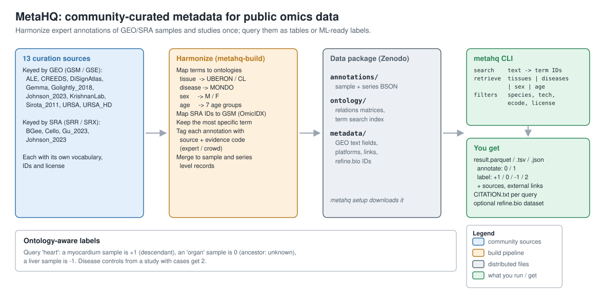
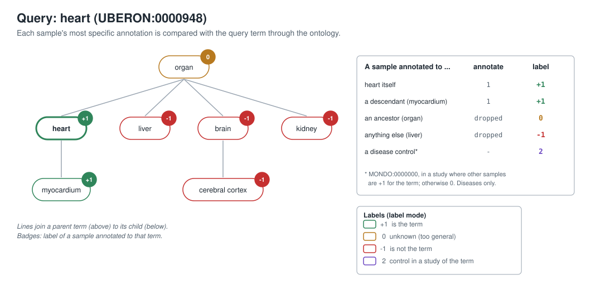

# How MetaHQ works

Public repositories such as GEO and SRA hold millions of omics samples, but
the metadata that says *what* each sample is (its tissue, disease, sex or age)
is free text written by each submitter. Many groups have hand-curated parts of
that metadata for their own projects. MetaHQ collects those curation efforts,
maps them to shared vocabularies, and serves them through one command-line tool.

The pipeline has three stages:

1. **Collect.** Thirteen community sources (Gemma, DiSignAtlas, Bgee, CREEDS,
   URSA, and others; see [citations](../about/citation.md)) each annotate some
   GEO or SRA samples or studies in their own vocabulary.
2. **Harmonize.** The `metahq-build` pipeline maps every annotation to an
   ontology term or a fixed value, converts SRA IDs to GEO sample IDs, keeps
   the most specific term per sample, and records which source said what. The
   result is published on Zenodo as the
   [MetaHQ data package](data-model.md).
3. **Query.** `metahq setup` downloads the data package once.
   `metahq retrieve` then filters it and writes a table (or JSON) with one row
   per sample or study and one column per requested term, plus a
   `CITATION.txt` that lists the sources you need to cite.

## Key concepts

### Attributes

MetaHQ annotates four attributes. Tissue and disease use ontologies, so
MetaHQ can reason about related terms; sex and age use fixed values.

| Attribute | Values | `retrieve` subcommand |
| --- | --- | --- |
| tissue (and cell type) | [UBERON](https://www.ebi.ac.uk/ols4/ontologies/uberon) and [CL](https://www.ebi.ac.uk/ols4/ontologies/cl) term IDs, e.g. `UBERON:0000948` (heart) | `metahq retrieve tissues` |
| disease | [MONDO](https://www.ebi.ac.uk/ols4/ontologies/mondo) term IDs, e.g. `MONDO:0004994` (cardiomyopathy). `MONDO:0000000` marks a healthy control | `metahq retrieve diseases` |
| sex | `M`, `F` (also accepts `male`, `female`, `PATO:0000384`, `PATO:0000383`) | `metahq retrieve sex` |
| age | `fetus`, `infant`, `child`, `adolescent`, `adult`, `older_adult`, `elderly_adult` | `metahq retrieve age` |

Use `metahq search` to turn free text such as "heart attack" into term IDs.

### Levels: samples and series

GEO calls a study a *series* (`GSE…`) and a sample a `GSM…`. MetaHQ keeps two
annotation records:

- **sample level** (`--level sample`, the default): one record per GSM. SRA-only
  annotations are mapped to their GSM through [OmicIDX](https://github.com/omicidx/omicidx).
- **series level** (`--level series`): one record per GSE, summarizing what the
  study contains. A series can carry several terms for one attribute.

### Evidence codes

Every annotation carries an evidence code:

- `expert` (`expert-curated`): assigned by curators reading the study.
- `crowd` (`crowd-sourced`): assigned through crowd-sourcing (CREEDS).

`--filters ecode=expert` keeps only expert annotations, `ecode=any` keeps both.

### Filters

`--filters` takes comma-separated `key=value` pairs:

| Filter | Values | Default when the key is left out |
| --- | --- | --- |
| `species` | `human`, `mouse`, `rat`, `zebrafish`, `fly` | `human` |
| `tech` | `rnaseq`, `microarray` (decided by the GEO platform, `GPL…`) | `rnaseq` |
| `ecode` | `expert`, `crowd`, `any` | `any` |

If you leave out `--filters` entirely, the default is
`species=human,ecode=expert,tech=rnaseq`. Note the asymmetry: omitting the flag
gives expert-only annotations, while passing `--filters species=mouse` gives
`ecode=any`.

### Sources and licenses

Each annotation remembers its source. The `sources` column of every result
lists the sources behind each row (pipe-separated), and `CITATION.txt` lists
them with full references and annotation counts.

Sources carry different licenses. `--license` limits a query to:

- `permissive`: CC0 and CC BY sources only (usable commercially, with attribution).
- `nc`: only non-commercial sources (CC BY-NC and academic-only).
- `any` (default): everything.

See the [Terms and Conditions](../about/terms_conditions.md) before using
annotations commercially.

## Annotations versus labels

For tissues and diseases, `--mode` decides how the ontology is used.

**`--mode annotate`** (default) answers "which samples are this term?". A sample
gets a `1` for a query term if it is annotated to that term *or any of its
descendants*. A sample annotated to `myocardium` counts as `heart`. Samples with
no `1` in any requested column are left out. A `0` in a returned row means
"not annotated to this term", which is not the same as "is not this term".

**`--mode label`** answers "is this sample the term, not the term, or unknown?",
which is what a classifier needs. Every sample with an annotation for the
attribute is returned, with one of:

| Label | Meaning |
| --- | --- |
| `1` | annotated to the term or a descendant: a positive |
| `0` | annotated only to an *ancestor* of the term (e.g. "organ" when you asked for "heart"): too general to say |
| `-1` | annotated to something unrelated: a negative |
| `2` | diseases at sample level only: a healthy control (`MONDO:0000000`) from a study in which other samples are `1` for the term |

A disease control is `0` for terms that its study does not have positives for,
and is left out if its study has no positives for any requested term.

Sex and age have no ontology, so they only support direct annotations (`0`/`1`).

## The three packages

MetaHQ is a monorepo with three Python packages:

| Package | Purpose | Install |
| --- | --- | --- |
| `metahq-cli` | the `metahq` command | `pip install metahq-cli` |
| `metahq-core` | querying, ontology propagation, export; used by the CLI | installed with `metahq-cli` |
| `metahq-build` | builds the data package from raw sources (maintainers only) | from a clone; see [Packages Overview](../developer/index.md) |

Next: [the data model](data-model.md) describes the files in the data package,
and [use cases](../user-guide/use-cases.md) walks through common queries.
