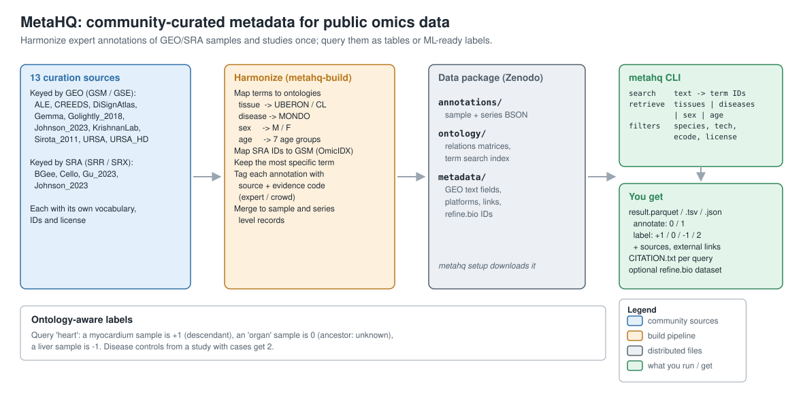

# MetaHQ Documentation

MetaHQ is a hub for **high-quality annotations** of public omics samples and
studies. It gathers tissue, disease, sex and age annotations that researchers
curated by hand for samples in GEO and SRA, maps them to shared ontologies
(UBERON/CL, MONDO), and lets you query them from the command line as tables or
as machine-learning-ready labels.



The construction of the MetaHQ database would not be possible without efforts from the greater biomedical
research community. All of our annotations come from fellow researchers interested in using publicly
available biomedical data that understand the difficulty in finding samples and studies of interest.

We encourage researchers to submit their high-quality, manually curated annotations to be included in
the MetaHQ database! See our documentation for information on how
to [contribute](contribute/index.md).

## Features

- 🔍 **Annotation Retrieval**: Query standardized and harmonized biomedical annotations
  for samples or whole studies, filtered by species, technology, evidence and license
- 🧬 **Ontology-aware**: A query for "heart" also finds samples annotated to "myocardium"
- 🧠 **ML-Ready Outputs**: Retrieve +1/0/-1 labels (and disease controls) for classification tasks
- 📚 **Provenance**: Every row lists its sources, and every query writes a `CITATION.txt`
- 🖥️ **CLI Interface**: User-friendly command-line tools

## A first query

```bash
pip install metahq-cli
metahq setup                                   # download the database once
metahq search --query "heart" --type tissue --ontology UBERON -k 3
metahq retrieve tissues --terms "UBERON:0000948" --mode label --output heart_labels
```

## Quick Links

- [Installation](getting-started/installation.md)
- [Quick Start](getting-started/quickstart.md)
- [How MetaHQ works](concepts/overview.md): attributes, levels, evidence codes, annotate vs label
- [Data model](concepts/data-model.md): what is in the data package and in each result file
- [Use cases](user-guide/use-cases.md): tested recipes for common questions
- [User Guide](user-guide/setup.md)

## Paper

MetaHQ is described in Hicks *et al.*, *Bioinformatics*:
[https://doi.org/10.1093/bioinformatics/btag814](https://doi.org/10.1093/bioinformatics/btag814).
The preprint is at [https://arxiv.org/abs/2602.07805](https://arxiv.org/abs/2602.07805).

## Terms and Conditions

Before using MetaHQ, please read our full [Terms and Conditions](about/terms_conditions.md).

The MetaHQ database is released under **CC BY-NC 4.0** ([Creative Commons Attribution-NonCommercial 4.0 International](about/database_license.md))
because several source datasets carry NonCommercial restrictions.

**For commercial use:** You must either:

1. Obtain permissions from sources with NonCommercial restrictions
2. Use only annotations from sources with commercial-compatible licenses (CC0, CC BY)

Our software is released under the [BSD 3-Clause](about/software_license.md).

## Getting Help

Open an issue on [GitHub](https://github.com/krishnanlab/meta-hq) if you encounter any issues or have questions:
